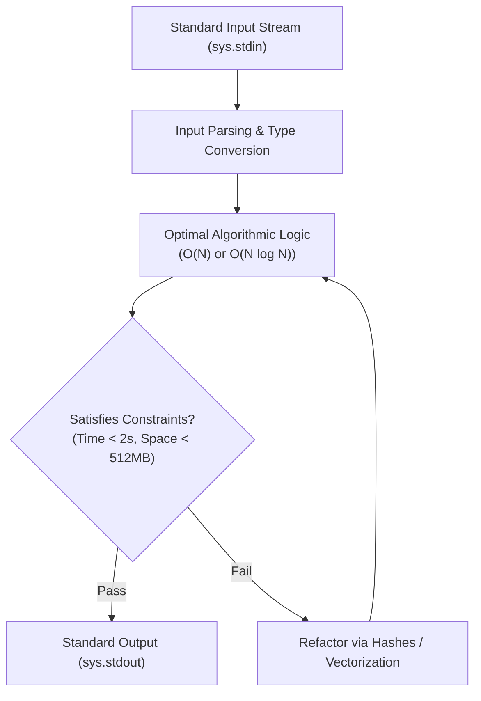

# 🏆 HackerRank Python Solutions — High-Performance Algorithmic Challenges

<p align="center">
  
</p>

<p align="center">
  <b>Competitive Programming Solutions: Data Structures, String Transformations, Hash Map Lookups, and Combinatorics.</b>
</p>

<p align="center">
  
  
  
  
</p>

<p align="center">
  
</p>

---

<a id="table-of-contents"></a>
## 📌 Table of Contents

- [📖 Executive Summary & Overview](#executive-summary--overview)
- [🎯 Key Features & Capabilities](#features)
- [🏗️ System Architecture & Pipeline](#system-architecture--pipeline)
- [🛠️ Tech Stack Breakdown](#tech-stack-breakdown)
- [⚙️ Reproducible Quickstart & Setup](#setup)
- [📁 Project Directory Layout](#project-layout)
- [🔮 Future Improvements & Roadmap](#future-improvements--roadmap)
- [🤝 Contributing Guidelines](#contributing-guidelines)
- [👨‍💻 Author & Contributions](#author--contributions)

---

<a id="executive-summary--overview"></a>
## 📖 Executive Summary & Overview

Competitive programming and algorithmic problem solving cultivate sharp analytical reasoning, optimal time/space complexity optimization, and rigorous handling of extreme boundary constraints. Solving problems on platforms like **HackerRank** reinforces mastery of native Python language mechanics: dictionary lookups ($O(1)$), hash sets, sorting algorithms ($O(N \log N)$), regular expressions, and string parsing.

The **HackerRank Python Solutions** repository consolidates verified, competitive solutions authored by **Amaraiah C** across HackerRank problem domains: Warmup, Strings, Data Structures, Math, and Regex.

---

<a id="key-features--capabilities"></a>
## 🎯 Key Features & Capabilities

### ⚡ 1. High-Efficiency Collections
- Utilizing `collections.Counter` and `defaultdict` for linear-time frequency analysis.

### 🔤 2. String Manipulation & Parsing
- Regular expression parsing, anagram checks, palindrome testing, and string mutations.

---

<a id="system-architecture--pipeline"></a>
## 🏗️ System Architecture & Pipeline



---

<a id="tech-stack-breakdown"></a>
## 🛠️ Tech Stack Breakdown

| Component | Module | Usage |
| :--- | :--- | :--- |
| **Runtime** | Python 3.10+ | Competitive programming interpreter |
| **High-Performance Collections** | `collections`, `heapq`, `deque` | Priority queues, counters, double-ended queues |
| **Combinatorics** | `itertools` | Cartesian products, permutations, combinations |
| **Pattern Matching** | `re` | Regular expression token extraction |

---

<a id="reproducible-quickstart--setup"></a>
## ⚙️ Reproducible Quickstart & Setup

### Prerequisites
- Python 3.8+ installed

```bash
# 1. Clone repository
git clone https://github.com/Amaraiah11/Python-hacker-rank-.git
cd Python-hacker-rank-

# 2. Run competitive Python script
python -c "print('HackerRank Competitive Environment Ready')"
```

---

<a id="project-directory-layout"></a>
## 📁 Project Directory Layout

```text
Python-hacker-rank-/
├── pythonw.exe                # Local Python interpreter executable runtime
└── README.md                  # Comprehensive problem-solving documentation & index
```

---

<a id="future-improvements--roadmap"></a>
## 🔮 Future Improvements & Roadmap

- [ ] Add LeetCode and Codeforces solutions index.
- [ ] Implement graph traversal algorithms (Dijkstra, BFS/DFS).

---

<a id="author--contributions"></a>
## 👨‍💻 Author & Contributions

This project is developed and maintained with rigorous engineering standards by **Amaraiah C**, Software Developer and Applied Data Analytics Practitioner studying Bachelor of Computer Applications (BCA) at Alliance University, Bangalore.

- 🌐 **GitHub Profile:** [@Amaraiah11](https://github.com/Amaraiah11)
- 💼 **LinkedIn Profile:** [Connect on LinkedIn](https://www.linkedin.com/in/amaraiah-c/)
- 📧 **Institutional Email:** `camaraiahBCA24@ced.alliance.edu.in`

### 🤝 Contributing Guidelines
Contributions, bug reports, and architectural discussions are welcome!
1. **Fork** the repository: `https://github.com/Amaraiah11/Python-hacker-rank-`
2. **Create a Feature Branch:**
   ```bash
   git checkout -b feature/your-feature-name
   ```
3. **Commit Your Enhancements:**
   ```bash
   git commit -m "feat: enhance feature logic"
   ```
4. **Push to Your Branch:**
   ```bash
   git push origin feature/your-feature-name
   ```
5. **Open a Pull Request** against the `main` branch.

---

<p align="center">
  <b>⭐ If this codebase or documentation assisted your engineering workflows, please star the repository! ⭐</b>
</p>

<p align="center">
  
</p>
